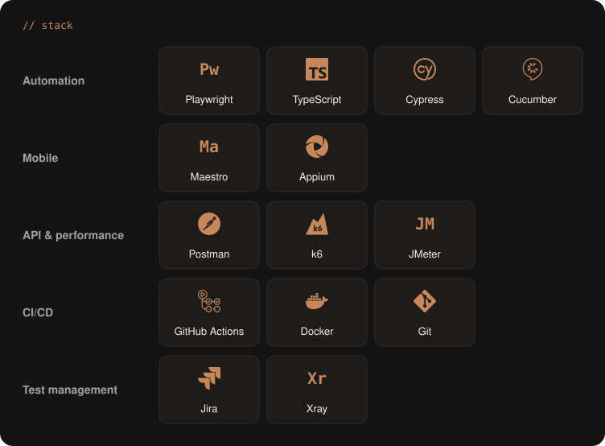
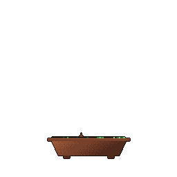

# Hi, I'm Carlos Alcalá 👋

**Quality, end to end.** From requirements to production.

QA Specialist · Agentic QA · Test automation for web, API & mobile · Quality in CI/CD
📍 Lima, Perú · remote

Quality isn't a filter: it lives in every stage of development. I work in financial services (private banking and wealth management), where I conceived my team's first institutional automation framework and taught a manual-testing team to work with it. Within three months every QA had at least one automated flow.

## What I work on

- **Test automation frameworks:** layered Playwright + TypeScript architecture with atomic test cases, reusable components, linting, hooks, documented architecture decisions and runbooks.
- **Web, API & mobile:** end-to-end flows across modern and legacy platforms, API coverage with reusable sessions, and mobile tests with Maestro (previously Appium).
- **Quality in CI/CD:** GitHub Actions workflows that act as a quality gate: a failing test blocks the merge.
- **Agentic QA:** agents that generate, run and repair BDD tests autonomously. I validate findings before they are reported, to keep false positives out of bug reports.
- **Test management integration:** reusable tooling between test frameworks and Xray / Jira.

## Open source

- [**playwright-ci-reference**](https://github.com/alcarcis/playwright-ci-reference): layered Playwright tests with a real CI quality gate on GitHub-hosted runners (sharded runs, merged report, secret scan, SHA-pinned actions).
- [**pw2xray**](https://github.com/alcarcis/pw2xray): reusable Playwright ↔ Xray integration library (TypeScript).

## Tools

## Contact

- Website: [alcarcis.com](https://alcarcis.com)
- LinkedIn: [linkedin.com/in/alcarcis](https://www.linkedin.com/in/alcarcis)
- Email: [hola@alcarcis.com](mailto:hola@alcarcis.com)

🇪🇸 En español

**La calidad no es un filtro: existe en cada etapa del desarrollo.**

Soy QA Specialist en servicios financieros (banca privada y gestión patrimonial). Ideé el primer framework de automatización institucional de mi equipo de calidad y enseñé a trabajar con él a un equipo que venía de pruebas manuales: en tres meses, cada QA tenía al menos un flujo automatizado.

Hoy automatizo web, API y aplicaciones móviles (Playwright, TypeScript, Maestro), preparo las pruebas para funcionar como puerta de calidad en CI y trabajo con agentes que generan, ejecutan y reparan pruebas de forma autónoma; yo valido los hallazgos antes de reportarlos.

  

